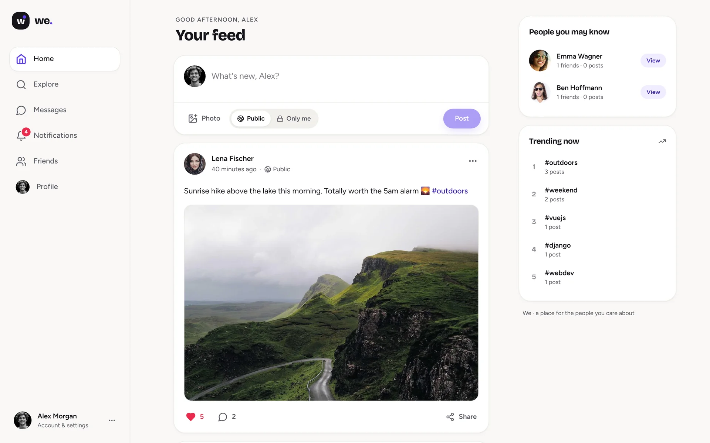
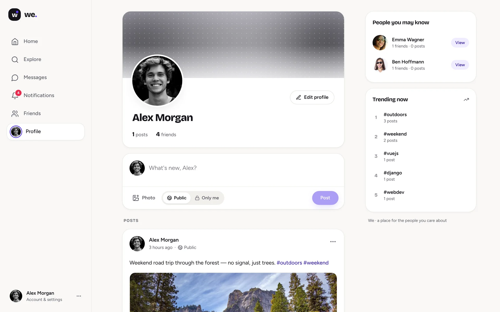
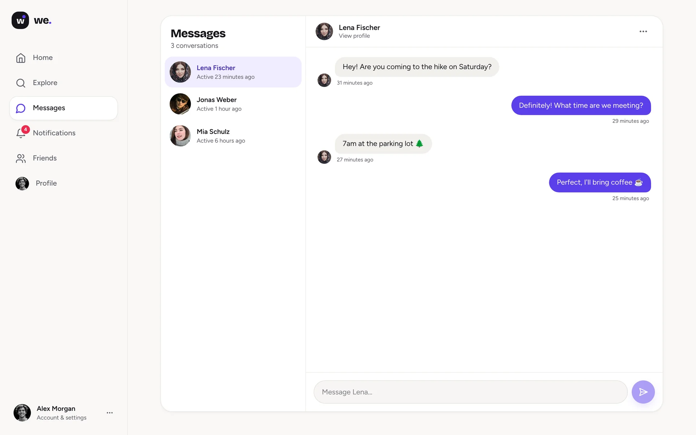
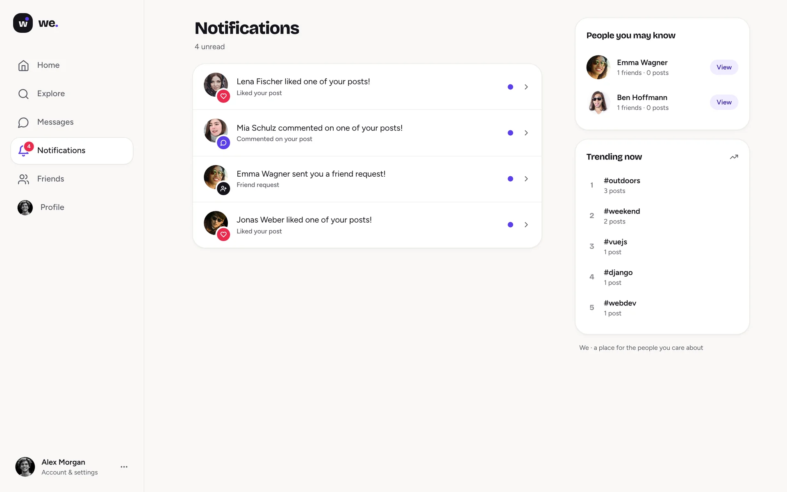
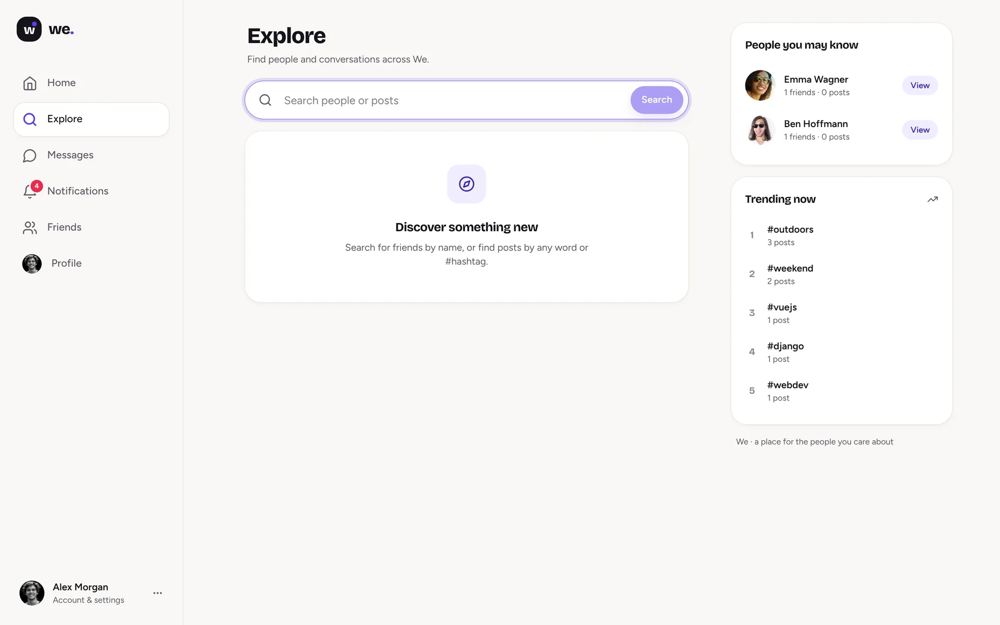
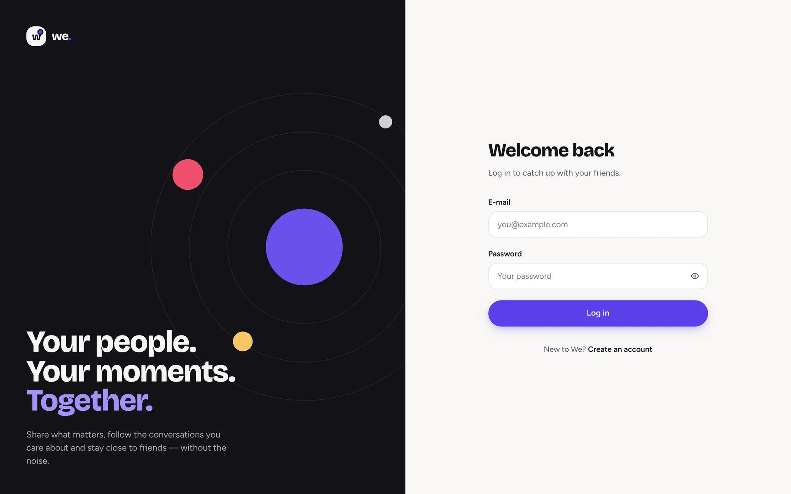
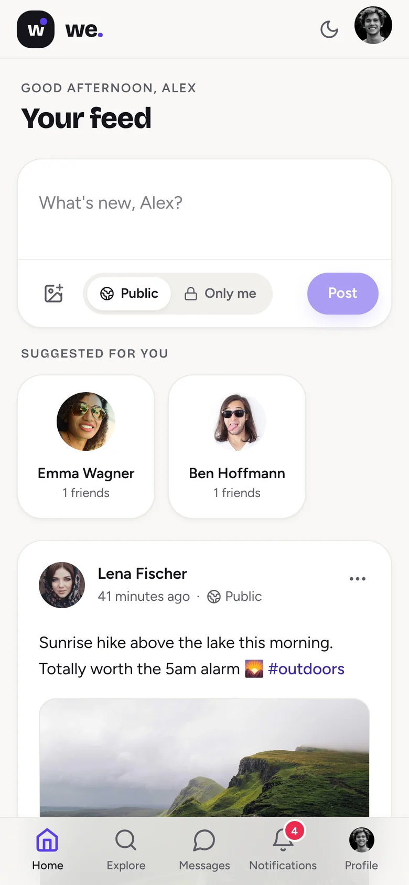
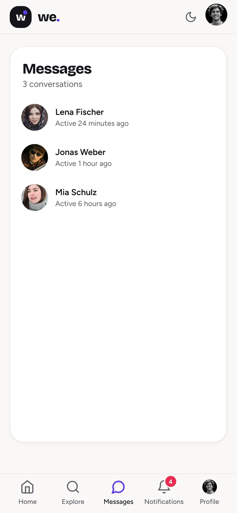

# We Social Network

**We** is a social network for sharing what matters and staying close to friends. You can post updates and photos, follow trending hashtags, chat one-on-one and manage friend requests. It all comes in a clean interface with light and dark mode that works on desktop and mobile.

I built it as a hands-on project for learning Python Django and practising real-world features end to end. The backend is a Django REST API and the frontend is a Vue.js 3 single-page app styled with Tailwind CSS.

**Live:** https://we-social-network.web.app/



## Features

- **Accounts:** sign up with e-mail activation, JWT login, and editable profile, avatar and password
- **Feed:** text and photo posts, likes, comments, sharing, and reporting posts
- **Private posts:** publish to everyone or keep a post visible to you only ("Only me")
- **Friends:** send, accept and reject friend requests, plus "People you may know" suggestions
- **Trends and Explore:** trending hashtags and search for people and posts
- **Messages:** one-on-one conversations
- **Notifications:** likes, comments and friend requests, with an unread badge
- **Light and dark mode**, and a responsive layout with a bottom tab bar on mobile

## Screenshots

### Desktop

| | |
|---|---|
|  |  |
|  |  |



### Mobile

<p>
  
  
</p>

## Tech stack

| Part | Technologies |
|---|---|
| Backend | Python, Django 4.2, Django REST Framework, Simple JWT, SQLite |
| Frontend | Vue.js 3, TypeScript, Vite, Pinia, Vue Router, Tailwind CSS, Radix Vue, Lucide icons |
| Hosting | PythonAnywhere (API), Firebase Hosting (web app) |

## Roadmap

- [x] Dark mode
- [x] Private posts
- [x] Image uploads for posts and avatars
- [ ] Real-time chat
- [ ] Infinite scroll in chats
- [ ] "Forgot password"
- [ ] Playwright end-to-end tests
- [ ] Progressive Web App (PWA)

## Getting started

### Backend

```bash
cd backend

# Create and activate a virtual environment
python -m venv venv
source venv/bin/activate        # Windows: venv\Scripts\activate

# Install dependencies
pip install -r requirements.txt

# Create the database and start the API on http://127.0.0.1:8000
python manage.py migrate
python manage.py runserver
```

> On Python 3.12 or newer, also run `pip install "setuptools<81"`. The pinned `djangorestframework-simplejwt` still imports `pkg_resources`.

New accounts are activated through an e-mail link. In development, Django prints that e-mail to the console. You can also create an admin with `python manage.py createsuperuser`.

The scripts in `backend/scripts/` refresh friend suggestions and trending hashtags. Run them on a schedule in production:

```bash
python scripts/generate_friend_suggestions.py
python scripts/generate_trends.py
```

### Frontend

```bash
cd frontend

# Install dependencies
npm install

# Start the dev server on http://localhost:5173
npm run dev

# Type-check and build for production
npm run build

# Lint
npm run lint
```

The API URL comes from `VITE_API_URL` in `frontend/.env` for development and in `frontend/.env.production` for production builds.

## Deployment

- **Backend:** any Python host works. I use [PythonAnywhere](https://www.pythonanywhere.com/). Configure it with environment variables (on PythonAnywhere, set them at the top of the WSGI file):

  | Variable | Example | Default |
  | --- | --- | --- |
  | `DJANGO_DEBUG` | `False` | `True` |
  | `DJANGO_SECRET_KEY` | output of `python -c "from django.core.management.utils import get_random_secret_key as k; print(k())"` | dev key, **required** when debug is off |
  | `DJANGO_ALLOWED_HOSTS` | `api.example.com` | empty |
  | `DJANGO_WEBSITE_URL` | `https://api.example.com` | `http://127.0.0.1:8000` |
  | `DJANGO_CORS_ALLOWED_ORIGINS` | `https://example.web.app` | `http://localhost:5173` |
  | `DJANGO_CSRF_TRUSTED_ORIGINS` | `https://example.web.app` | `http://localhost:5173` |
  | `DJANGO_AUTH_THROTTLE_RATE` | `10/minute` | `10/minute` (login/signup per IP) |

  Lists are comma separated.
- **Frontend:** set your API URL in `frontend/.env.production`. Then log in with the [Firebase CLI](https://firebase.google.com/docs/cli) (`firebase login`), select your project (`firebase use <project-id>`) and run:

  ```bash
  npm run deploy
  ```
